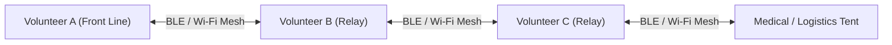

# 🛡️ DisasterManagement: Field User Guide & Operations Manual
**Secure, Zero-Cloud, Off-Grid Communications for Ground Coordinators, Social Workers & Civil Protection Teams**

---

## 📌 1. Overview: What This App Does

The **DisasterManagement** application is an off-grid civil protection and secure mesh communication platform designed for scenarios where cellular networks, Wi-Fi backhauls, and terrestrial communication infrastructure are disrupted, throttled, or unavailable.

### Core Guarantees
* **100% Off-Grid:** Operates completely without Internet, SIM cards, cellular towers, or central servers.
* **Zero Registration & Anonymity:** No mobile numbers, OTP verification, email addresses, or cloud accounts are needed.
* **End-to-End Hybrid Quantum-Resistant Encryption:** Every transmission is sealed using **ML-KEM-768 (Kyber-768)** and **X25519** with **ChaCha20-Poly1305 / AES-256-GCM**.
* **Traffic-Analysis Resistance:** Every message, beacon, audio note, and alert is uniformly padded to **exactly 4,096 bytes**. Third-party observers scanning radio frequencies cannot distinguish an emergency SOS from a routine text or voice memo.
* **Instant Panic Purge:** A single button destroys cryptographic keys, overwrites file headers with random noise, and terminates the app instantly if a device is at risk of seizure.

---

## 📲 2. How to Get & Install the App

### A. Downloading the Package
* **Local Package:** `DisasterManagement-v1.0.0-signed.apk` (18 MB)
* **Direct Web Link:** [Download v1.0.0 Signed APK](https://github.com/Plaguedoctor-sudo/DisasterManagement/releases/download/v1.0.0/DisasterManagement-v1.0.0-signed.apk)
* **GitHub Releases:** [v1.0.0 Releases Page](https://github.com/Plaguedoctor-sudo/DisasterManagement/releases/tag/v1.0.0)

### B. Installing on Android (Android 10 and above)
1. **Transfer the APK to your phone:**
   * Download directly via mobile browser, or
   * Receive via **Quick Share / Nearby Share / Bluetooth**, or
   * Copy via a **USB OTG Pendrive** or micro-SD card.
2. Tap on `DisasterManagement-v1.0.0-signed.apk` to begin installation.
3. If Android prompts *"For your security, your phone is not allowed to install unknown apps from this source"*:
   * Tap **Settings**.
   * Toggle **"Allow from this source"** ON.
   * Tap **Back** and select **Install**.
4. The tactical shield icon will appear on your home screen.

### C. Permissions Required & Why
Upon first launch, grant the necessary hardware permissions:
* **Nearby Devices / Bluetooth:** Required for phone-to-phone off-grid mesh communications.
* **Location (While using app):** Mandatory requirement by Android OS to scan for Bluetooth Low Energy (BLE) beacons. *The app never transmits or uploads your location to any remote server.*
* **Microphone (Optional):** Required only if you use Push-to-Talk (PTT) voice memos.
* **Camera (Optional):** Required only if you use the Optical Fountain QR transceiver.

---

## 📡 3. How Off-Grid Mesh Networking Works

The app transforms participating Android smartphones into a self-healing, peer-to-peer radio relay network.

### 1. Bluetooth Low Energy (BLE) Mesh (Passive Relaying)
* Operates continuously in the background within a **10–30 meter radius**.
* **Store-and-Forward Hopping:** If Person A wants to reach Person C who is 80 meters away, intermediate devices running the app automatically relay the encrypted packet without being able to decrypt or tamper with it.

### 2. Wi-Fi Local Hotspot Mesh (High-Speed Local Bubble)
* For faster data sync and voice memo transfers, one coordinator can turn on their phone's **Personal Hotspot** (mobile data does *not* need to be active).
* Other volunteers simply connect their Wi-Fi to that hotspot.
* The app automatically discovers peers on UDP Port 42424 and syncs encrypted incident feeds over TCP Port 42425.

### 3. Near-Ultrasound Acoustic Modem (Audio Chirping)
* If radio frequencies (Bluetooth/Wi-Fi) are actively jammed or prohibited:
* The app can broadcast critical emergency pulses over speaker sound frequencies (18.5 kHz – 19.5 kHz) directly into nearby phone microphones.

### 4. Optical Fountain Transceiver (Camera & Screen Droplets)
* True air-gapped physical transfer.
* Displays animated Luby Transform QR fountain codes on the screen at 8 frames per second.
* Another volunteer scans the animated QR codes with their camera to reconstruct the complete data package.

---

## 🔘 4. Tactical Interface & Button Actions

The main screen features high-contrast, glove-friendly macro buttons designed for rapid response under stress:

| Button | Function | Wire Priority | Recommended Use Case |
| :--- | :--- | :--- | :--- |
| 🟢 **I AM SAFE** | Status Check-In | Standard (Pool B) | Broadcasts civilian status check-in with optional GPS coordinates to update your team. |
| 🔴 **TRAPPED / AID** | Emergency SOS | High / Priority (Pool A) | Immediately broadcasts high-priority distress alerts across the mesh and triggers an ultrasonic acoustic chirp. Reserved for injuries, encirclement, or urgent rescue. |
| 🟡 **NEED SUPPLIES** | Logistics Request | Standard (Pool B) | Opens a 1-tap selector to request **Water, Medical Supplies, Food, Shelter, Power, or Tools**. |
| ⚠️ **HAZARD REPORT** | Perimeter Danger Alert | Standard (Pool B) | Reports immediate local dangers (Barricades, Water Cannons, Tear Gas, Live Wires, Structural Collapse). |
| 🎙️ **PUSH-TO-TALK** | Encrypted Voice Memo | Media (Pool C) | Press and hold to record audio. Automatically sliced and encrypted into 4KB invariant envelopes. |
| 🚨 **PANIC PURGE** | **Emergency Memory Shred** | **Hardware Immediate** | **Zeroes encryption keys, wipes the encrypted database headers, and forcefully kills the app process.** |

---

## 🔒 5. Security & High-Risk Field Protocols

### Understanding Panic Purge
* In high-risk environments or situations where phones may be seized, inspected, or subjected to search:
* Tap **PANIC PURGE**.
* The application immediately erases its hardware-backed master keys from the Android KeyStore, zeroes internal memory pages using native C `mlock` routines, wipes database decryption headers, and halts.
* **Warning:** Data destroyed via Panic Purge is cryptographically irrecoverable.

### Recommended Device Hygiene for Field Operations
1. **Use Strong PINs:** Avoid fingerprint or face-unlock biometric mechanisms in crowded public spaces; use a 6+ digit alphanumeric PIN.
2. **Disable Lock Screen Notification Previews:** In Android Settings, set notifications to *"Don't show sensitive content on lock screen"*.
3. **Carry Power Banks:** Active Bluetooth and Wi-Fi mesh routing increases battery consumption. Keep a 10,000+ mAh portable power bank available.
4. **App Battery Optimization:** In Android App Settings for DisasterManagement, ensure Battery is set to **"Unrestricted"** so Android does not kill background mesh routing when the screen turns off.

---

## 📋 6. Step-by-Step Operations Checklist for Group Gatherings

### Before Arriving at the Location
- [ ] Have all core coordinators, medical volunteers, and team leads install `DisasterManagement-v1.0.0-signed.apk`.
- [ ] Open the app once while still on home Wi-Fi to confirm all permissions (Bluetooth, Location) are granted.
- [ ] Test a localized check-in message between two phones to verify peer discovery.
- [ ] Fully charge all devices and power banks.

### On the Ground
1. **Establish Relay Chains:** Place volunteers or static relay stations (e.g., info desks, medical tents, perimeter teams) spaced every 20–30 meters to ensure seamless message hopping.
2. **Logistics Coordination:** Use the **🟡 NEED SUPPLIES** tab to maintain accurate counts of drinking water and first aid materials across stations.
3. **Emergency Alerting:** If any volunteer is separated, detained, or injured, trigger **🔴 TRAPPED / AID** to notify all connected phones in the mesh network immediately.

---

## ❓ 7. Troubleshooting & FAQ

**Q: Do I need a working SIM card or phone network?**  
*No.* The application works even in Airplane Mode with Bluetooth and Wi-Fi turned manually back on, or on phones with no SIM cards installed.

**Q: Why does the app need "Location" permission?**  
*Android OS requires Location permission to allow apps to perform Bluetooth Low Energy (BLE) hardware scans.* The application never uploads your coordinates to the cloud, and GPS coordinates are only shared if you explicitly include them in a check-in.

**Q: What is the range between phones?**  
* Standard Bluetooth: 10 to 30 meters depending on crowd density and obstructions.
* Wi-Fi Hotspot: 30 to 70 meters.
* Through mesh hopping (phone-to-phone-to-phone), messages can travel hundreds of meters across a crowd.

**Q: Where can I get updates or report bugs?**  
Source code, documentation, and releases are maintained at:  
👉 `https://github.com/Plaguedoctor-sudo/DisasterManagement`
