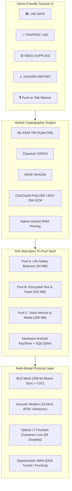

# 🛡️ DisasterManagement

> **Off-Grid Civil Protection & Tactical Mesh Communications Platform**  
> *Engineered for Android smartphones and tablets when cellular towers, power grids, and terrestrial backhauls collapse.*

[](https://opensource.org/licenses/Apache-2.0)
[-green.svg)](https://developer.android.com)
[](https://csrc.nist.gov/pubs/fips/203/final)
[](#core-architectural-invariants)

---

## ⚡ Quick Download & Installation

### Option 1: Direct APK Installation (Fastest)
1. **Download the Signed Production APK:**
   - Download directly from GitHub Releases:  
     👉 **[Download DisasterManagement-v1.0.0-signed.apk](https://github.com/Plaguedoctor-sudo/DisasterManagement/releases/download/v1.0.0/DisasterManagement-v1.0.0-signed.apk)** *(27 MB)*  
   - Or browse the [v1.0.0 Release Page](https://github.com/Plaguedoctor-sudo/DisasterManagement/releases/tag/v1.0.0).
2. **Transfer to Device:**
   - Transfer via USB cable, SD card, Bluetooth, or local Wi-Fi share (or download directly in your mobile browser).
3. **Install:**
   - Tap the downloaded `.apk` file on your device.
   - If prompted, allow *"Install unknown apps"* for your browser or file manager.
   - Tap **Install**. The tactical shield launcher icon will appear on your home screen.

### Option 2: Sideload via ADB (Developers & Field Ops)
```bash
# Verify device connection
adb devices

# Install signed release package
adb install -r DisasterManagement-v1.0.0-signed.apk

# Launch application
adb shell am start -n network.disaster.management/.MainActivity
```

---

## 📡 Core Capabilities & Architecture



### 1. 4,096-Byte Uniform Packet Invariant
Every transmission across any physical medium (text, GNSS beacon, triage alert, voice chunk, or optical droplet) is padded to an invariant length of exactly **4,096 bytes**. Packet-size side channels and traffic pattern analysis are eliminated.

### 2. Hybrid Post-Quantum Cryptography
- **ML-KEM-768 (FIPS 203 Kyber-768)** quantum-resistant key encapsulation.
- **X25519** classical Elliptic Curve Diffie-Hellman scalar multiplication.
- **HKDF-SHA256** combined key derivation with **ChaCha20-Poly1305** and **AES-256-GCM**.
- **Native C11 `mlock()` Memory Pinning:** Cryptographic secrets and decrypted payloads are locked in RAM to prevent Android paging to swap or storage wear.

### 3. Anti-Starvation Tri-Pool Storage
Flash storage is partitioned into non-starving quotas:
* **Pool A (Emergency Life-Safety):** 50 MB hard reservation. Distress beacons and critical alerts are **never** crowded out by audio or map files.
* **Pool B (Encrypted Tactical Feed):** 250 MB quota for team communications and check-ins.
* **Pool C (Bulk Media & Voice Notes):** 200 MB quota for push-to-talk audio memos and maps.
* **Low-Wear Subkey Shredding:** Deleting a bundle zeroes only its 32-byte ephemeral key, rendering payloads unrecoverable without causing flash wear.

### 4. Multi-Modal Physical Transports
* **BLE Mesh Transceiver:** Duty-cycled background scanning with L2CAP Connection-Oriented Channels and **256-bit Bloom Filter summaries** for ultra-efficient epidemic sync.
* **Near-Ultrasound Acoustic Modem:** 4FSK chirping over speaker/microphone across 18.5 kHz – 19.5 kHz for short-range sound communication.
* **Optical LT Fountain Transceiver:** Air-gapped visual data stream beaming animated Luby Transform QR droplets at 8 FPS, reconstructed via real-time CameraX peeling decoder.
* **Opportunistic WAN Egress:** Fallback Base32 Port 53 DNS tunneling and domain fronting to escape captive portals.

---

## 🛠️ Glove-Friendly Tactical Incident Interface

| Tactical Macro | Destination Pool | Wire Action |
| :--- | :--- | :--- |
| 🟢 **I AM SAFE** | Pool B | Broadcasts civilian status check-in with GPS coordinates |
| 🔴 **TRAPPED / AID** | Pool A | Broadcasts priority SOS beacon + transmits 18.5 kHz ultrasonic chirp |
| 🟡 **NEED SUPPLIES** | Pool B | Opens rapid selector: Water, Medical, Food, Shelter, Power, Tools |
| ⚠️ **HAZARD REPORT** | Pool B | Reports immediate hazards: Live Wire, Gas Leak, Fire, Flood, Collapse |
| 🎙️ **PUSH-TO-TALK** | Pool C | Encodes voice memo into 2,800-byte slices inside 4KB invariant envelopes |
| 🚨 **PANIC PURGE** | Device Hardware | Destroys database keys, overwrites headers with noise, terminates app |

---

## 🔒 Security & Privacy Guarantees

* **Zero Cloud Dependencies:** Requires no accounts, phone numbers, Google Play Services, or central servers.
* **Hardware-Backed Master Key:** Database passphrases sealed inside device **Android KeyStore (TEE / StrongBox)**.
* **Cleartext Traffic Blocked:** Strict Android Network Security Configuration disallowing cleartext HTTP.
* **Isolated FileProvider:** Media attachments strictly scoped to avoid leaking internal storage.

---

## 💻 Building from Source

### Prerequisites
* JDK 17 (`JAVA_HOME`)
* Android SDK 34 (`ANDROID_HOME`) with CMake and NDK installed

### Compile & Build
```bash
# Clone the repository
git clone https://github.com/Plaguedoctor-sudo/DisasterManagement.git
cd DisasterManagement

# Run unit tests
./gradlew testReleaseUnitTest

# Build signed release APK
./gradlew assembleRelease

# Output binary location:
# app/build/outputs/apk/release/app-release.apk
```

---

## 📜 License

Licensed under the **[Apache License 2.0](LICENSE)**. Open source, royalty-free, and civil protection friendly.
